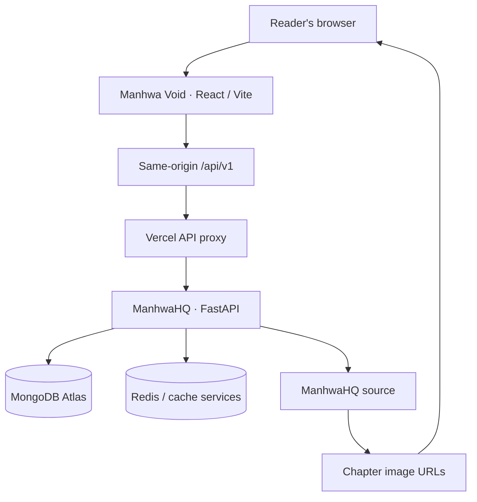

<div align="center">


# MANHWA VOID

### DISCOVER · READ · SAVE · RESUME

**Your reading space for manga, manhwa, manhua and webtoons.**


<br />

[🌐 Open Manhwa Void](https://manhwavoid.space) · [⚙️ API project](https://github.com/Quanxi-void/Quanxi)

<br />

[Explore features](#-the-experience) · [User guide](#-user-guide) · [Run locally](#-run-the-frontend) · [Deployment](#-deployment) · [Roadmap](#-improvements--roadmap)

</div>

---

## ✦ The experience

Manhwa Void is a responsive reading frontend designed around a simple flow: **find something worth reading, open a chapter, and pick up where you left off.**

The interface brings discovery, title information, a focused chapter reader and a personal library into one place. The frontend is built with React, TypeScript and Vite and connects to the ManhwaHQ API.

<div align="center">

|  |  |  |
|:---:|:---:|:---:|
| Browse · Search · Explore | Chapters · Reader · Navigation | Bookmarks · History · Continue Reading |

</div>

## ✦ The experience

<table>
<tr>
<td width="50%" valign="top">

### ⌂ Home & discovery

- Curated homepage sections.
- Hero and featured title presentation.
- Trending and popular titles.
- Latest chapter updates.
- Recommended titles.
- Popular ongoing list.
- Continue Reading for signed-in readers.
- Quick access to browse and search.

</td>
<td width="50%" valign="top">

### ◈ Browse & search

- Discover manga, manhwa, manhua and webtoons.
- Search titles by name.
- Browse with pagination.
- Filter by type and genre.
- Sort by Latest, Popular, Top Rated and A–Z.
- Random-title discovery.
- Dedicated genre navigation.

</td>
</tr>
<tr>
<td width="50%" valign="top">

### ▤ Title details

- Cover and banner artwork.
- Primary and alternate title information when supplied.
- Synopsis and available metadata.
- Chapter list and reading entry points.
- Related-title recommendations.
- Bookmark and share actions.
- Direct jump into a selected chapter.

</td>
<td width="50%" valign="top">

### ▣ Chapter reader

- Dedicated, distraction-reduced reading view.
- Chapter page images loaded from their source URLs.
- Previous and next chapter navigation.
- Chapter list panel.
- Reading progress information.
- Back-to-top control.
- Keyboard navigation where supported.
- Signed-in reading progress synced to account history.

</td>
</tr>
<tr>
<td width="50%" valign="top">

### ♡ Personal library

- Create an account and sign in.
- Save and remove bookmarks.
- Persistent manga reading history.
- Continue Reading list on the homepage.
- Hide a title from Continue Reading without deleting its history.
- Remove one history entry.
- Clear all reading history.

</td>
<td width="50%" valign="top">

### ⚙ Profile & preferences

- Edit profile information.
- Public profile page.
- Avatar presets and supported avatar options.
- Account and security settings.
- Change username, email and password.
- Appearance preferences, including the available theme options.
- Profile tabs kept focused on Bookmarks, History and Settings.

</td>
</tr>
</table>

## ✦ A closer look at the personal library

The personal library is designed to keep reading progress separate from the homepage's Continue Reading display.

<details>
<summary><b>Continue Reading — hide is not delete</b></summary>

1. Sign in to your Manhwa Void account.
2. Open a chapter while signed in so the API can record reading progress.
3. Your title can appear in the homepage's **Continue Reading** row.
4. Use the small **×** control on a card to hide that title from this row.
5. Hiding it does not erase the saved reading-history entry.
6. Open your profile's **History** tab to find your saved reading history.

</details>

<details>
<summary><b>Bookmarks</b></summary>

1. Open a title page.
2. Use the bookmark action to save the title.
3. Open your profile and select **Bookmarks**.
4. Select a saved title to return to its details.
5. Remove a title from the list when you no longer want to keep it.

</details>

<details>
<summary><b>Reading history</b></summary>

1. Sign in before reading to associate chapter progress with your account.
2. Open **Profile → History** to see saved reading entries.
3. Continue from a title's recorded chapter.
4. Remove a single entry if you want to clean up one title.
5. Use **Clear All** only when you want to remove the complete history list.

</details>

## ✦ User guide

<details open>
<summary><b>01 · Find a series</b></summary>

- Start on the homepage to see featured, trending, latest and recommended sections.
- Open **Browse** to explore the catalogue.
- Use the search field when you already know a title's name.
- Narrow the catalogue with genre or type filters.
- Change sorting to explore the latest or popular titles.
- Select a manga card to open its details page.

</details>

<details>
<summary><b>02 · Open a title and choose a chapter</b></summary>

- Review the synopsis and available title information.
- Browse the chapter list.
- Select a chapter to open the reader.
- Use the chapter panel to jump to another available chapter.
- Use the previous/next controls to move through the series.

</details>

<details>
<summary><b>03 · Read comfortably</b></summary>

- Use the dedicated reader view for chapter pages.
- Scroll through the page images.
- Use the back-to-top control on long chapters.
- Keyboard shortcuts, when enabled by the reader, are:

| Key | Action |
|:---:|---|
| `←` | Previous chapter |
| `→` | Next chapter |
| `Esc` | Close the chapter list panel |

Arrow-key navigation is ignored while typing in form fields or using modifier-key combinations.

</details>

<details>
<summary><b>04 · Create an account</b></summary>

- Open **Register** and enter the requested account details.
- After registration, sign in through **Login**.
- Keep your login credentials private.
- Sign in when you want reading history and bookmarks associated with your account.
- Use the profile settings to manage supported profile and security details.

</details>

<details>
<summary><b>05 · Manage your profile</b></summary>

Your current profile area is intentionally focused on three sections:

| Tab | What it is for |
|---|---|
| **Bookmarks** | Your saved titles |
| **History** | Your reading history, including individual removal and Clear All |
| **Settings** | Profile, account and preference controls |

The current profile does not document a separate activity feed, account-export screen, notifications tab or profile-summary dashboard.

</details>

## ✦ Genres

The frontend keeps a fixed local genre filter list so the navigation does not depend on a live genre-list request.

`Action` · `Adult` · `Adventure` · `Comedy` · `Drama` · `Fantasy` · `Harem` · `Horror` · `Mature` · `Mystery` · `Romance` · `Sci-Fi` · `Slice of Life` · `Sports` · `Supernatural`

## ✦ Interface & visual language

- **Dark-first interface:** deep charcoal surfaces with violet accents.
- **Light theme:** an alternate appearance is available.
- **Responsive layout:** desktop and mobile navigation patterns.
- **Brand identity:** the local `public/logo-mark.png` emblem and Cinzel Decorative display typography.
- **Readable UI:** Inter interface typography and consistent Lucide icons.
- **Reusable components:** title cards, covers, avatars, pagination, search, skeletons, empty states and error feedback.
- **Motion and feedback:** transitions, loading states and toast messages.

<div align="center">


<sub>Brand mark: <code>public/logo-mark.png</code> · Avatar artwork: <code>public/avatars/</code></sub>

</div>

## ✦ Application routes

| Route | Purpose |
|---|---|
| `/` | Homepage and discovery |
| `/browse` | Browse and filter the catalogue |
| `/search` | Search entry route, where configured |
| `/title/:slug` | Title details |
| `/title/:slug/chapter/:chapter` | Chapter reader |
| `/login` | Sign in |
| `/register` | Create an account |
| `/profile` | Signed-in personal library and settings |
| `/user/:username` | Public user profile |

## ✦ How the frontend connects to the API



The browser normally calls a relative `/api/v1` path. In production, the Vercel proxy forwards those requests to the backend. The backend origin and optional proxy secret belong in server-side Vercel environment variables, not in browser-exposed `VITE_*` variables.

## ✦ Technology

| Technology | Role |
|---|---|
| React 18 | UI components |
| TypeScript | Typed application code |
| Vite 6 | Development server and production bundler |
| React Router 6 | Client-side routing |
| Axios | HTTP requests and interceptors |
| Lucide React | Interface icons |
| CSS | Layout, themes and responsive styling |
| Vercel Functions | Same-origin API proxy |
| PWA manifest / service worker | Install experience and offline fallback |

Supporting implementation includes authentication-aware requests, access-token refresh handling, selected client-side TTL caching, lazy-loaded routes/pages and a production bundle check for accidental backend configuration leaks. The service worker does not cache API responses.

## ✦ Run the frontend

### Requirements

- Node.js 20 or newer.
- npm.
- A running compatible ManhwaHQ API for live catalogue and account features.

### 1. Clone the repository

```bash
git clone YOUR_FRONTEND_REPOSITORY_URL
cd ManhwaVoid-v3-main
```

### 2. Install dependencies

```bash
npm install
```

### 3. Configure local API proxy

The Vite development setup proxies API requests to `http://127.0.0.1:8000` by default. If your API runs elsewhere, create `.env.local`:

```env
VITE_DEV_API_TARGET=http://127.0.0.1:8000
```

Optional public configuration:

```env
VITE_SITE_NAME=Manhwa Void
VITE_API_BASE_URL=/api/v1
```

> **Security:** Never put MongoDB credentials, JWT signing secrets, `BACKEND_PROXY_SECRET` or private backend credentials in a `VITE_*` variable. Vite exposes those variables to browser code.

### 4. Start the development server

Start the API separately, then run:

```bash
npm run dev
```

Open:

```text
http://localhost:5173
```

### Available scripts

| Command | Purpose |
|---|---|
| `npm run dev` | Start the Vite development server |
| `npm run typecheck` | Run TypeScript checks |
| `npm run build` | Type-check and build the production frontend |
| `npm run preview` | Preview the production build locally |

The production build is written to `dist/`. The configured post-build check scans the generated bundle for backend configuration leaks.

## ✦ Deployment

### Vercel

This frontend is configured for Vercel and includes `vercel.json` plus `api/proxy.ts`.

1. Push the frontend repository to GitHub.
2. Import it into Vercel.
3. Use the Vite framework preset.
4. Add these server-side environment variables:

| Variable | Value |
|---|---|
| `BACKEND_URL` | Backend origin only, e.g. `https://api.example.com` |
| `BACKEND_PROXY_SECRET` | Optional shared secret, only if the backend enforces it |

5. Deploy the project.
6. Check `/api/v1/_proxy-status` and confirm the proxy is configured.
7. Check `/api/v1/health` to verify the API responds.

`BACKEND_URL` must be the backend origin without `/api/v1` appended. Redeploy after changing Vercel environment variables.

### Production checklist

- [ ] Use HTTPS.
- [ ] Keep backend secrets in Vercel server-side environment variables.
- [ ] Never expose private values through `VITE_*`.
- [ ] Configure the API's proxy-secret validation to match the Vercel secret, if enabled.
- [ ] Restrict CORS to intended origins if direct browser API access is enabled.
- [ ] Verify `/api/v1/_proxy-status`.
- [ ] Verify `/api/v1/health`.
- [ ] Test login, bookmarks and reading history on the deployed site.
- [ ] Confirm the service worker does not cache API requests.

## ✦ Improvements & roadmap

The items below are improvement directions, not claims that every item is already implemented.

- [ ] Add maintained screenshots of Home, Browse, Title Details, Reader and Profile.
- [ ] Add accessible labels and keyboard focus checks to every interactive control.
- [ ] Add visual regression checks for desktop and mobile layouts.
- [ ] Add frontend component and route-level automated tests.
- [ ] Measure Core Web Vitals on real devices.
- [ ] Audit image loading, lazy loading and layout shifts.
- [ ] Improve empty, loading and recoverable-error states consistently.
- [ ] Add a documented release/change log.
- [ ] Validate the PWA install and offline fallback on supported browsers.

## ✦ Project structure

```text
ManhwaVoid/
├── api/
│   └── proxy.ts                 # Vercel API reverse proxy
├── public/
│   ├── logo-mark.png            # Main brand emblem
│   ├── art/                     # Public artwork
│   ├── avatars/                 # Avatar artwork
│   ├── fonts/                   # Local display fonts
│   ├── icons/                   # PWA and platform icons
│   ├── manifest.webmanifest
│   ├── offline.html
│   └── sw.js                    # Production service worker
├── src/
│   ├── components/              # Shared interface components
│   ├── context/                 # Auth, bookmarks, theme and toast state
│   ├── hooks/                   # Reusable React hooks
│   ├── lib/                     # API client, HTTP, cache and utilities
│   ├── pages/                   # Home, browse, title, reader and auth
│   │   └── profile/             # Bookmarks, History and Settings
│   ├── styles/                  # Base, layout, page and reader styles
│   ├── types/                   # API and application types
│   ├── App.tsx
│   ├── config.ts
│   └── main.tsx
├── scripts/
│   └── check-leak.mjs           # Production bundle leak check
├── index.html
├── package.json
├── package-lock.json
├── vercel.json
└── vite.config.ts
```

## ✦ Project credits

<div align="center">

<table>
<tr>
<td align="center" width="50%">


### Qυαɳxι ヅ ⁶⁶⁶

**API & Backend**

<a href="https://t.me/quanxi_core">Telegram · @quanxi_core</a>

</td>
<td align="center" width="50%">


### ㊝ ˢᵘⁿᵍメJɪɴᴡᴏᴏ !!

**Frontend & UI**

<a href="https://t.me/sungjinwoo_ex">Telegram · @sungjinwoo_ex</a>

</td>
</tr>
</table>

**Manhwa Void**  
*Find your next world. Keep your place in it.*


</div>

---

<div align="center">

**MANHWA VOID · FRONTEND**

<sub>React · TypeScript · Vite · ManhwaHQ API</sub>

</div>
